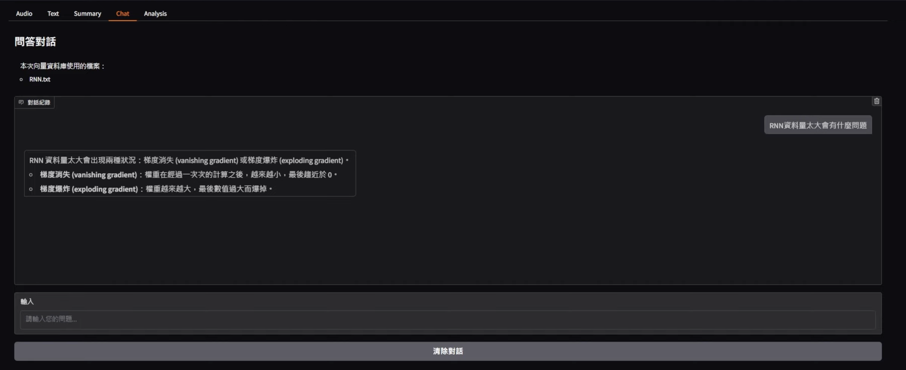
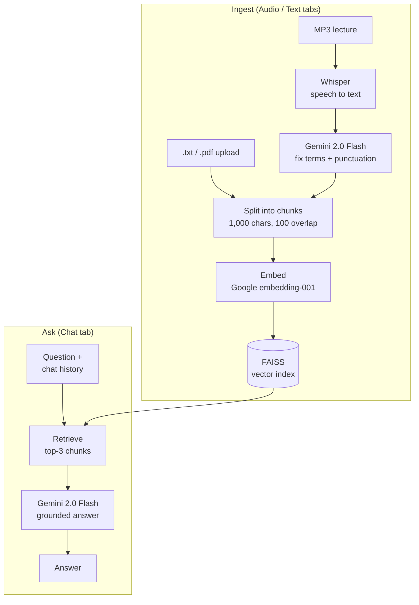

# Voice RAG Q&A

Ask questions about your lecture recordings in natural language.
Voice RAG Q&A transcribes audio with Whisper, uses Gemini to fix the technical terms Whisper gets wrong, indexes the text with FAISS, and answers questions with retrieval-augmented generation (RAG). It also includes a Gradio web UI.

English | [繁體中文](README.zh-TW.md)


*The Chat tab answering "What problems does an RNN run into when there is too much data?" from an indexed lecture transcript (UI in Traditional Chinese).*

**Demo video:** https://www.youtube.com/watch?v=YX8PeTnjxFg

## Features

- **Speech to text with error correction.** Whisper transcribes MP3 lectures. Gemini then rewrites misrecognized technical terms and adds punctuation and paragraphs. This raised transcription accuracy on technical terms from about 50% to over 90%.
- **Retrieval-augmented Q&A.** Transcripts and uploaded `.txt` / `.pdf` files are split into chunks, embedded, and stored in FAISS. Each question retrieves the 3 most relevant chunks, and Gemini answers using only that context, saying "I don't know" when the answer is not there.
- **Conversation memory.** Follow-up questions see the earlier turns of the chat.
- **Summaries.** One click produces a bullet-point summary of any transcript.
- **Learning analytics.** The app can export the query history and build a word cloud of the key nouns in past answers, which shows which topics you ask about most.

## How it works



1. **Transcribe:** Whisper (`base`) converts audio to raw text.
2. **Correct:** Gemini 2.0 Flash fixes recognition errors and formats the transcript.
3. **Index:** LangChain splits text into 1,000-character chunks (100-character overlap), embeds them with Google `embedding-001`, and stores them in FAISS.
4. **Answer:** The top-3 chunks and the chat history go into a grounded prompt for Gemini 2.0 Flash.

## Tech stack

Python · OpenAI Whisper · Gemini 2.0 Flash · LangChain · LlamaIndex · FAISS · Gradio · PyMuPDF · jieba · WordCloud

## Getting started

The project is a single notebook, `RAG.ipynb`. It is designed for Google Colab with Google Drive as storage.

1. Open `RAG.ipynb` in [Google Colab](https://colab.research.google.com).
2. In the **Environment** cell, set your Gemini API key (see [Get a Gemini API key](https://ai.google.dev/gemini-api/docs/api-key)):
   ```python
   GEMINI_API = "YOUR_GEMINI_API_KEY"
   ```
3. Set the paths:
   - `save_folder`: where audio and text files are stored (default: `/content/drive/MyDrive/RAG/`)
   - `font_path`: a font that supports Traditional Chinese, used for the word cloud (for example `NotoSansCJK-Regular.ttc`)
4. Run the first cell to install dependencies. If Colab asks to restart the session, click **Cancel**.
5. Run the remaining cells in order. The last cell prints a public Gradio URL such as `https://xxxxx.gradio.live`. Open it to use the app.

You can put MP3 files in `save_folder/voice/` beforehand, or upload them from the **Audio** tab.

## App tabs

| Tab | What it does |
|---|---|
| Audio | Upload MP3 files and transcribe them with error correction |
| Text | Upload `.txt` / `.pdf` files and build the vector index |
| Summary | Generate a bullet-point summary of a transcript |
| Chat | Ask questions; answers come from the indexed material |
| Analysis | Export query history and generate a keyword word cloud |
