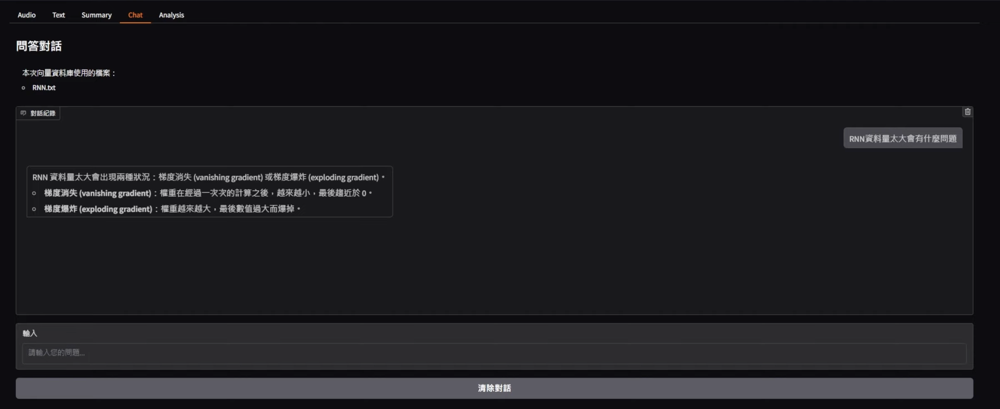
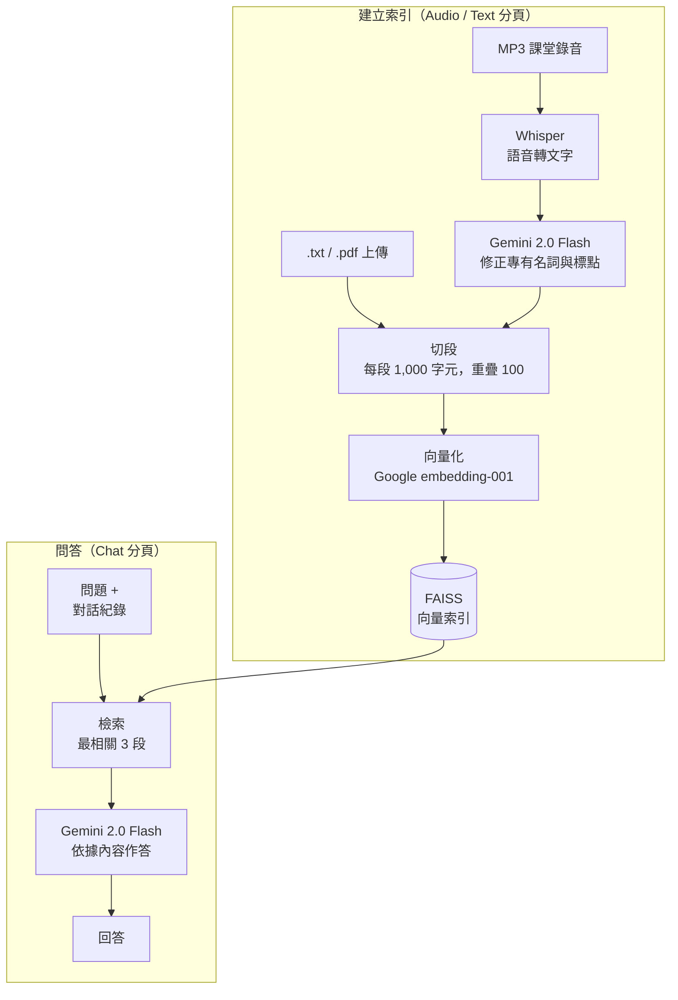

# Voice RAG Q&A：語音檢索問答系統

用自然語言詢問課堂錄音的內容。
本系統以 Whisper 將語音轉成文字，再由 Gemini 修正 Whisper 辨識錯誤的專有名詞，接著用 FAISS 建立向量索引，最後以檢索增強生成（RAG）回答問題，並提供 Gradio 網頁介面。

[English](README.md) | 繁體中文


*Chat 分頁根據已建立索引的課堂逐字稿，回答「RNN 資料量太大會有什麼問題」。*

**示範影片：** https://www.youtube.com/watch?v=YX8PeTnjxFg

## 功能

- **語音轉文字並自動修正。** Whisper 將 MP3 課堂錄音轉成逐字稿，Gemini 再修正辨識錯誤的專有名詞，並加上標點與分段。專有名詞的辨識正確率由約 50% 提升至 90% 以上。
- **檢索增強問答。** 逐字稿與上傳的 `.txt` / `.pdf` 檔會被切段、向量化並存入 FAISS。每個問題會取出最相關的 3 個段落，Gemini 只根據這些內容作答；找不到答案時會回答「不知道」，不會自行編造。
- **對話記憶。** 追問時會參考先前的對話內容。
- **摘要。** 一鍵產生任一逐字稿的條列式摘要。
- **學習分析。** 可匯出查詢紀錄，並從過去的回答中擷取關鍵名詞產生詞雲，看出自己最常詢問哪些主題。

## 運作方式



1. **轉錄：** Whisper（`base` 模型）將音檔轉成原始逐字稿。
2. **修正：** Gemini 2.0 Flash 修正辨識錯誤，並整理成有標點、分段的逐字稿。
3. **建立索引：** LangChain 將文字切成每段 1,000 字元（重疊 100 字元），以 Google `embedding-001` 向量化後存入 FAISS。
4. **作答：** 最相關的 3 個段落與對話紀錄一起放入提示詞，交由 Gemini 2.0 Flash 回答。

## 技術

Python · OpenAI Whisper · Gemini 2.0 Flash · LangChain · LlamaIndex · FAISS · Gradio · PyMuPDF · jieba · WordCloud

## 快速開始

整個專案是一個 Notebook：`RAG.ipynb`，設計在 Google Colab 上執行，並以 Google Drive 存放檔案。

1. 在 [Google Colab](https://colab.research.google.com) 開啟 `RAG.ipynb`。
2. 在 **Environment** 區塊填入你的 Gemini API 金鑰（申請方式見 [Gemini API 金鑰說明](https://ai.google.dev/gemini-api/docs/api-key?hl=zh-tw)）：
   ```python
   GEMINI_API = "YOUR_GEMINI_API_KEY"
   ```
3. 設定路徑：
   - `save_folder`：存放錄音與文字檔的資料夾（預設為 `/content/drive/MyDrive/RAG/`）
   - `font_path`：支援繁體中文的字型，用來產生詞雲（例如 `NotoSansCJK-Regular.ttc`）
4. 執行第一個區塊安裝套件。若 Colab 要求重新啟動工作階段，請按**取消**。
5. 依序執行其餘區塊。最後一個區塊會輸出 Gradio 的公開網址，例如 `https://xxxxx.gradio.live`，點開即可使用。

你可以事先把 MP3 檔放進 `save_folder/voice/`，也可以之後在 **Audio** 分頁上傳。

## 介面分頁

| 分頁 | 功能 |
|---|---|
| Audio | 上傳 MP3 檔並轉成修正後的逐字稿 |
| Text | 上傳 `.txt` / `.pdf` 檔並建立向量索引 |
| Summary | 產生逐字稿的條列式摘要 |
| Chat | 提問，系統根據已建立索引的內容作答 |
| Analysis | 匯出查詢紀錄並產生關鍵字詞雲 |
